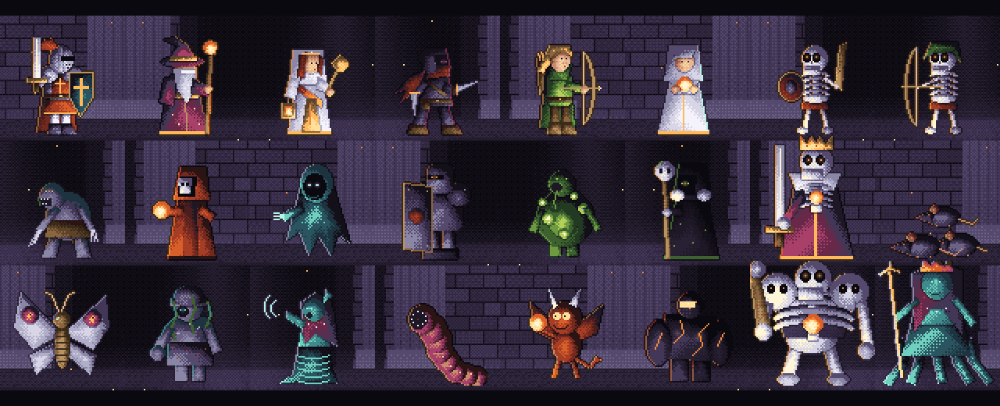
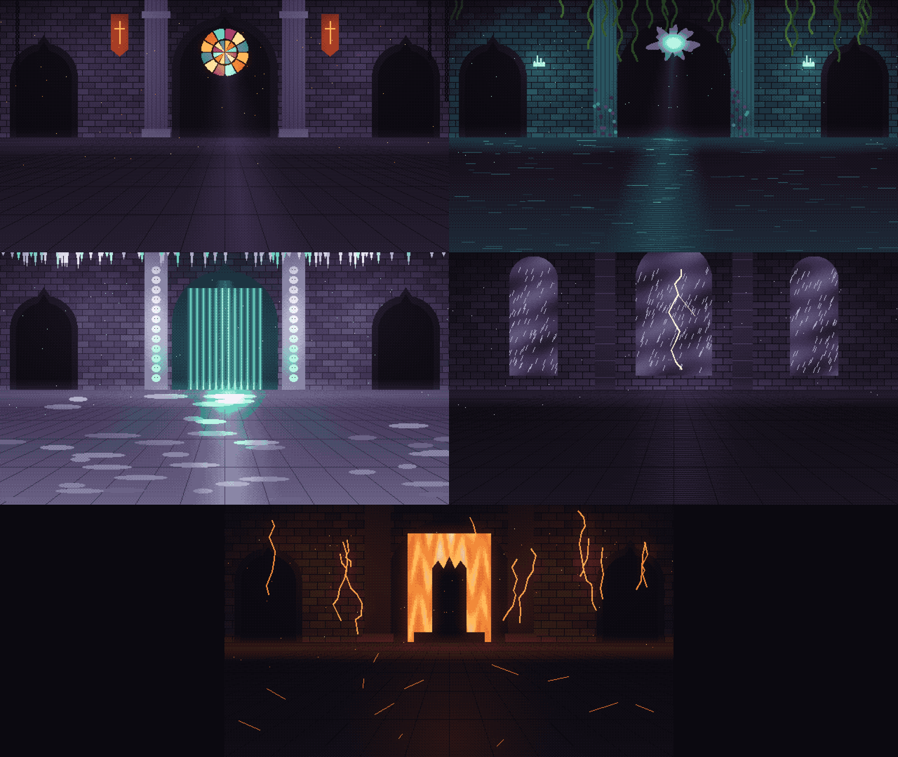

# Ashenbound: The Last Ember

A turn-based roguelite RPG built with **Godot 4.7 (.NET)** and **C#**. Pick three heroes, descend through five
regions of a cursed vault, and rekindle the Last Ember by defeating the Hollow King.



## Features

**Quality of life**
- Battles save after every action: quitting mid-fight (or a crash) resumes the battle exactly where it was
  (the battle is rebuilt by replaying its recorded commands on the same seed).
- Rebindable keys, three text sizes, a reduce-motion option (no shake, hit-stops or flashes) and a colour-blind
  friendly palette for elements and health bars.

**Enemy tactics**
- On top of each enemy's script, enemies react to the fight: one pip from breaking they brace, wounded elites and
  bosses get desperate, healers cover the ally closest to breaking, and elites and bosses focus a hero they can
  finish (or an Empowered or Marked one) and avoid melee-ing into a Riposte. Every choice still shows in the intent.
- Finishers and duo techniques get a cinematic (the world darkens, slow motion, the name slams in), and the last
  enemy of a fight dies in a kill-cam.

**Combat**
- Initiative-based turn order, front and back rows (melee can only reach the front row).
- Four elements (Physical, Fire, Ice, Lightning) with weaknesses, resistances and immunities.
- Break system: hitting weaknesses depletes an enemy's break meter; a broken enemy loses its turn and takes double damage.
- Honest enemy intents: every enemy shows exactly what it will do and to whom, including charged attacks.
- 14 status effects with explicit duration and stacking rules (poison caps at 20, shields at max HP), hero resources
  (Resolve, Mana, Faith, Combo, Focus, Rage, Hex, Reagents, Charge) and cooldowns.
- No stun-locks: a unit that just lost a turn shrugs off the next stun; bosses can't be stunned by abilities and their
  break meter grows each time they recover.
- Defending halves damage, builds resource and shakes off a lingering affliction.
- Combat log explains every number (`20 base, x1.5 weak, x2 broken, -3 armor`) and every miss (hit chance).
- Optional timing-based parry.
- Team combos: one hero sets up a status, another cashes it in with the right element: *Shatter* (Slow + physical),
  *Ignite* (Poison + fire), *Overload* (Burn + lightning, arcs to every enemy), *Frostbite* (Bleed + ice).
  The targeting preview shows when a hit will trigger one.

**Content**
- 9 heroes (4 unlockable: Brakka the Berserker, Sable the Hexer, Corvin the Alchemist and Isolde the Spellblade),
  each with 5 abilities and 6 level-up traits.
- 7 regions. Every run opens in the Ashen Crypt and ends at the Cinder Throne; the three regions in between are
  drawn from a pool of five (Drowned Halls, Frozen Ossuary, Storm Spire, Rotting Garden, Silent Archive), so no two
  runs take the same road. A region played deeper than usual gets tougher enemies. Each region has its own enemies, elites, music, ambience and a boss with a unique mechanic, its own theme
  and a cinematic entrance (letterbox, regional arrival, title card with a hint at its mechanic):
  - *The Bone Colossus* exposes a different weak point every round (two in phase 2).
  - *The Drowned Matriarch* floods the front row, so heroes have to fall back; in phase 2 an Undertow alternates
    with the flood and drags at the back row.
  - *Vaelith the Frost Lich* is shielded by her phylactery until it is destroyed; shattering it tears at her soul.
  - *Kharos the Storm Tyrant* brands a hero and then strikes them with lightning; in phase 2 the brand forks across
    the back row and the strike hits every branded hero.
  - *The Mother Bloom* is healed every round by her living seed pods; in phase 2 she starts eating them.
  - *The Archivist* adapts: the element that hit it last deals half damage, so the party has to keep switching.
  - *The Hollow King* seals heroes' abilities (his intent names which one) and devours his own minions; in phase 2
    he also exposes a shifting weak point, combining what the earlier bosses taught.
- 55 enemy types (including 12 elites and 7 bosses), plus random elite modifiers (Frenzied, Armored, Splitting, Vampiric, Thorned, Volatile).
- Omens that change single fights (Blood Moon, Thick Fog, Ember Storm, Crumbling Floor...) and optional bounties
  (win fast, trigger a combo, break two enemies...) that pay extra gold.
- Monsters talk: every family has its own synthesized voice (formant synthesis of a made-up tongue) and lines for
  taunts, attacks, pain and death.
- Branching map with battles, elites, events, treasure, shops, rest sites, toll gates and golden rooms.
- Story cutscenes, in-battle dialogue and event chains that span the whole run.

**Progression**
- Gold, XP, equipment, relics, consumables and ability upgrades within a run. Most upgrades add a twist beyond
  bigger numbers (interrupts, works from either row, cleanses, extra statuses, ignores armor).
- Fifteen weapon-family weapons (Common / Rare / Legendary) that change how a hero plays, each with a drawback:
  Embercleaver breaks guards, Oathbreaker executes broken enemies, the Ashwood Longbow hunts marked prey,
  Windpiercer never misses, Gutterfangs strike twice, Last Whisper trades blood for cheaper abilities,
  Warden's Pike reaches the back row and punishes charging enemies, Oathkeeper counters after guarding,
  the Stormglass Focus arcs elemental hits, the Gravemason hammer smashes shields and sunders armor, and the
  Cinder Tome sets enemies burning, the Gravewheat Scythe sweeps into a second enemy, the Penitent's Flail cracks
  break meters on crits, the Vigil Lantern heals with ability damage and the Rimefang Rapier slows on crits.
  Heroes swing the weapon they actually carry. Bosses always offer one as a reward.
- Combo relics that reward setting something up (Static Sigil, Shatterglass Charm, Sentinel's Oath, Hunter's Tally)
  and tactical consumables (Warding Flask before a big hit, Thunder Flask to chip every break meter, Shock Dart to
  interrupt a charged attack).
- Equipment rewards and shop items show what every hero has in that slot now; the Wandering Smith can reforge a
  plain weapon into one with a signature mechanic.
- Ember Shards carry over between runs and buy permanent upgrades and hero unlocks.
- Hero mastery: every hero earns mastery XP in the runs they join. Adept unlocks a full costume redesign
  (Cinderforged Juggernaut, Storm Sage, Sunpriestess, Kitsune, Wildwarden, Bear Jarl, Grave Witch, Clockwork
  Tinkerer, Dragon Knight), Veteran an alternative ability that replaces one of their four, and Mastered starts
  every run with their basic attack upgraded. Loadouts are picked on the hero select screen.
- Endless mode: after beating the Hollow King, "Descend Deeper" keeps the party and goes round the vault again with a
  new map and region order and much tougher enemies; the deepest descent is recorded.
- Weekly challenge: one seed, one party (any hero, locked ones included) and three rule-changing mutators per week
  (Splitting Plague, Powder Keg, Ill Omens, Bounty Season, Glass Party, Frenzy, Brittle Bones, Ironclad, War Drums,
  Pauper's Road).
- Duo techniques: nine hero pairs unlock a joint ability in battle when both are in the party (shown on hero select).
- Special rooms: the Ember Forge, the Shrine of Pacts, the Lantern Caravan, the Hunt, and the Sealed Door with a
  secret boss, the Ember Wyrm.
- Pact relics: big blessings with real curses (Bloodstone Crown, Glass Heart, Idol of Greed, Hollow Lantern, Doom
  Clock, Pact of Thorns).
- Lore codex: 20 pages found by entering regions, defeating bosses and reaching milestones (Compendium → Lore).
- Run summary and history: the end screen shows the route, the MVP, the biggest hit and what killed the party;
  the Compendium keeps the last 20 runs.
- 18 Feats (long-term goals across runs: clear every region, break 40 enemies, trigger 25 combos, win at Heat 5...)
  that pay shards, and four of them unlock new weapons into the loot pool.
- Daily challenge (same seed, party and modifier for everyone) and 5 Heat difficulty levels that change decisions
  (more enemy modifiers, pricier shops, weaker rests, shielded enemies) rather than only adding HP.
- One-time contextual tips the first time you meet a charge, a break, a mark, a boss phase or an enemy modifier.



## Running the game

1. Install [Godot 4.7 .NET](https://godotengine.org/download) and the [.NET 8 SDK](https://dotnet.microsoft.com/download).
2. Clone this repository and open `project.godot` in Godot.
3. Press **F5**. The first launch imports the assets and builds the C# project.

**Controls:** mouse, or keyboard only (arrows / Tab move between buttons, Enter confirms). In battle, **1-9** select actions, **Tab / arrows + Enter** pick targets,
**Esc** cancels or pauses, **Space** parries. **F11** or **Alt+Enter** toggles fullscreen.

## Tests

The game rules are covered by an xUnit project that compiles `Scripts/Core` without Godot:

```
dotnet test Tests
```

It checks content integrity (every enemy, summon and encounter id exists), the damage rules, status stacking and
stun protection, boss escalations, weapons, relics and consumables, reward generation, map generation, save/load
round trips and seed reproducibility, turn order and target validation, loop protection, and plays every encounter
with every hero to make sure no battle can soft-lock and no value (HP, resources, shields, poison, break) ever
leaves its bounds.

The same run also writes `Tests/balance_report.md`: a greedy bot plays every elite and boss with every party and
compares all weapons, so outliers (a weapon far ahead, a boss nobody beats, an ability never worth using) stand out.

## Architecture

```
Scripts/
  Core/                 Pure C# game rules, no Godot dependencies
    Data/               Content as data: heroes, abilities, enemies, items, relics, traits, regions
    Combat/             Battle state machine, damage and status rules, enemy AI, battle events
    Run/                Run state, map generation, events, story, meta-progression, save/load
  Game/                 Scene flow, saving, audio, global hotkeys
  UI/
    Components/         Reusable UI: unit views, pickers, panels, pause menu
    Scenes/             One script per screen (menu, map, battle, rewards, shop, cutscenes...)
Scenes/                 One .tscn per screen; all UI is built in code
Art/, Audio/            Generated assets and the Python scripts that generate them
```

The battle rules are a deterministic state machine that resolves instantly and emits a stream of events
(hits, statuses, deaths, phase changes). The UI replays those events with animations. Keeping the rules
separate from presentation makes them testable and prevents soft-locks caused by interrupted animations.

Runs, the profile and settings are saved as JSON. Seeded randomness means reloading a run gives the same results.

## Assets

All art and audio are original and generated procedurally:
- `Art/style_kit.py`, `units_v2.py`, `backgrounds_v2.py`, `ui_v2.py`: pixel art with a fixed 38-color palette,
  shaded color ramps, ordered dithering, outlines and baked lighting (Python + Pillow + NumPy).
- `Audio/music_v2.py`, `music_v3.py`: music synthesized from scratch (strings, brass, choir, organ, celesta, harp,
  FM electric piano, drums, convolution reverb) and rendered to seamless loops (NumPy + SciPy + ffmpeg): a distinct
  theme per region, a boss variant of each, and a lo-fi campfire track for rest sites.
- `Audio/voices.py`: monster voices from a formant synthesizer (glottal source, vowel formants, consonant bursts,
  growl, whisper, ring modulation, octave-down boss doubles).

## Author

Luka Antonić, [@antsdz0r](https://github.com/antsdz0r)
